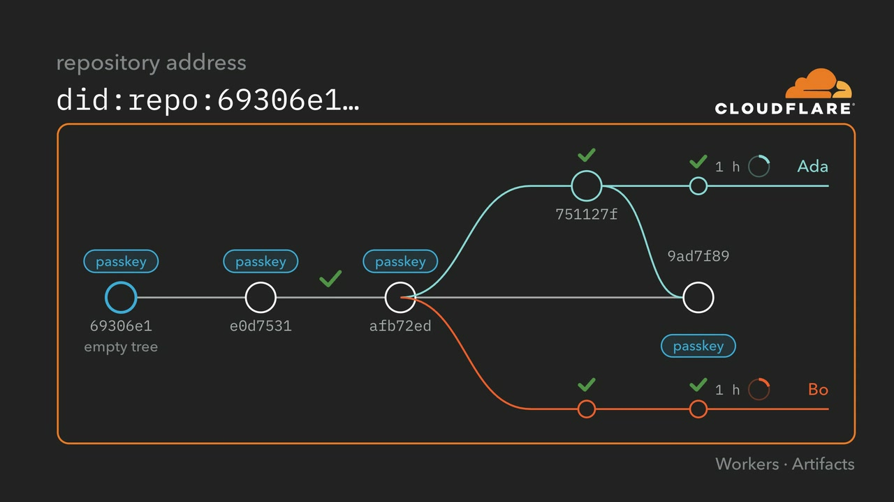

# Open Integrity Forge

**A Git platform for agents in which the platform cannot make a commit valid.**

Today, an AI agent can create a pull request, run a review, and trigger a deployment. Every system downstream sees a valid login, but none of them know: *did a person who is allowed to approve this actually intend this specific change?* Though the Git platform may be able to answer the question, that just gives it all the power, and whoever compromises the platform acquires that power too.

Open Integrity Forge moves that authority out of the platform and into the repository. Validity lives in Git:

- Every repository starts with a **signed first commit**, its root of trust. Its hash is the repository's id and its decentralized identifier, `did:repo:<hash>`: one address for the repository, the same on every host and in every clone.
- **Files committed in the repository** define the rules for who may sign what, and each commit is judged by the rules in force *before* it, so a key can never authorize itself.
- Agents work **at the same time, each in its own fork**, each signing with its **own key that lasts an hour**. They can write, sign and propose freely. They cannot merge.
- A change reaches `main` only when **a person signs that exact merge commit** with a passkey: both parents, the resulting tree and the message are covered by an ordinary Git SSH signature.
- **Anyone with a clone can check the whole history, on any host, without the forge in the loop.** Cloudflare hosts the repositories and GitHub can mirror them; neither can make a commit valid.

Open Integrity Forge runs on [Cloudflare Workers](https://developers.cloudflare.com/workers/), [Durable Objects](https://developers.cloudflare.com/durable-objects/), [Queues](https://developers.cloudflare.com/queues/) and [Artifacts](https://developers.cloudflare.com/artifacts/). Its sign-in, account settings and passkey approvals are built on [passkey-cloudflare](https://github.com/BlockchainCommons/passkey-cloudflare), Blockchain Commons' passkey-only identity library for Workers and Durable Objects. `packages/passkey-cloudflare` and `apps/demo` here are a copy of it, with one code change offered upstream ([BlockchainCommons/passkey-cloudflare#20](https://github.com/BlockchainCommons/passkey-cloudflare/pull/20): offer ES256 first, since only a P-256 passkey can make the SSH signature Git checks). It is part of the [Open Integrity Project](https://github.com/OpenIntegrityProject), a [Blockchain Commons](https://www.blockchaincommons.com) project, which describes the forge on its [developer site](https://developer.blockchaincommons.com/open-integrity/forge/).

**Live demo:** [https://forgedemo.gordianstack.com](https://forgedemo.gordianstack.com) (sign in with a passkey, then "Play the story")

**Video:** [Open Integrity Forge](https://www.youtube.com/watch?v=_KdOGtynXig), a seven-minute walkthrough of the demo

[](https://www.youtube.com/watch?v=_KdOGtynXig)

## What the demo shows

1. **Your passkey signs the first commit.** It is an empty inception commit, and its hash becomes the repository's id. The next commit, which your passkey also approves, sets the rules and names your passkey as the only promoter.
2. **You admit two agents, Ada and Bo.** Each gets an Ed25519 SSH key that lasts an hour and a fork of its own, with a write token for that fork only. Changing the rules needs your approval too.
3. **The agents work at the same time.** Each signs its commits with its own key and proposes them, and the forge checks every proposal against the rules in the repository.
4. **Bo tries to make its own key a promoter.** The commit is validly signed, but the repository still rejects it: a key can never authorize itself.
5. **You promote Ada's change.** Your passkey signs the merge commit, and `git verify-commit` checks that signature.
6. **Anyone can check it anywhere.** A fresh clone on a laptop, or a mirror on any Git host, gives the same answer.

"Play the story" stops wherever your passkey is needed and picks up from the furthest step the project has done, even after a reload. At its end, "Keep going" plays the rest of the video's tour: two agents conflict and the second redoes its change, a release, a key revoked, and an approval opened as a Gordian Envelope.

The demo also lets you revoke an agent's key, release `main` as a tag that carries your approval, make two agents conflict and redo the loser on the new `main`, and delete a project. Two features need a deployment setting that the live demo leaves off: pushing signed work from your own laptop needs `CF_API_TOKEN`, so the forge hears the push, and asking an agent to write a note with Claude needs an Anthropic API key. Every change is checked by the same rules. Settings holds your passkeys, recovery codes and sessions, and, for an operator, tools to look up, suspend or help a member recover.

## The rules

The policy is stored at `.repo/config/verification/policy.json`. A commit is checked against the policy of its first parent, so it cannot change the rules it obeys.

| Rule | Statement |
| --- | --- |
| R0 | The first commit of `main` is the root of trust. Its approval verifies against the promoter key in its own policy. Its hash is the repository id. |
| R1 | Each later commit of `main` requires an approval from a promoter in the policy of its first parent. |
| R2 | Only a commit of `main` with such an approval can change `.repo/`. A key that a commit adds has no say over that commit. |
| R3 | Each other commit that `main` reaches must carry a valid SSH signature from a key in the policy in force when it came in. |
| R4 | An approval must name this repository, the ref, the parents, and the tree of its own commit. |
| R5 | An author key may sign only inside its validity window. |
| R6 | A key a promoter revoked may sign nothing after its revocation; its earlier work still verifies. |
| R7 | Where the policy says `mergesOnly`, a commit of `main` with one parent changes only `.repo/`, so that no squash will drop the authors' signatures. |
| R8 | A release tag of a `main` commit carries approvals of that tag from as many distinct promoters as `releaseApprovals` requires. |
| M | A proposal merges into `main` with no conflicts (proposals only). |

A promoter approves a change of `main` by signing the commit itself: a WebAuthn assertion whose challenge is the commit's SSHSIG data, stored as the commit's SSH signature in OpenSSH's `webauthn-sk-ecdsa-sha2-nistp256@openssh.com` format. The commit message ends with a `Forge-Approval` trailer naming the repository, the ref, the parents, and the tree, which the signature covers. A release tag carries its approvals in its message instead. Each approval can also be read as a [Gordian Envelope](https://developer.blockchaincommons.com/envelope/).

## Check a repository with no forge

The verifier is one file, `forge-verify.mjs`, which each new repository pins by its SHA-256 digest. "Show the commands" on the page gives the exact commands with a read-only token that lasts an hour:

```sh
git clone https://<account>.artifacts.cloudflare.net/git/forge-demo/<repo>.git notes
curl -fsSLO https://<forge>/forge-verify.mjs
shasum -a 256 forge-verify.mjs          # must match the digest the repository pins
node forge-verify.mjs notes --repo <the id of the first commit>
```

`--repo` takes the hash in the repository's `did:repo` address, so a clone of any other repository fails, whatever host served it.

The verifier requires Node 22 or later, prints each commit with its rules, and exits 0 when all pass. Git alone checks every signature:

```sh
TZ=UTC git -C notes -c gpg.ssh.allowedSignersFile=.repo/config/verification/allowed_commit_signers log --show-signature
```

Stock Git checks every commit: the agents' commits carry ordinary SSH signatures, and each commit of `main` carries the passkey's signature, listed in `allowed_commit_signers` as the OpenSSH security key it signs with. Run it with `TZ=UTC`, since under daylight saving time, Git on macOS checks a key's window an hour late. `forge-verify` adds the policy of each commit's parent, key windows and revocation, and release approvals (which are not available with Git alone).

## Run it locally

To run locally, you need Node 23.6 or later and Git. No Cloudflare account is needed: locally, repositories live in Durable Objects that keep the Artifacts contract.

```sh
npm install
npm run dev -w forge          # http://localhost:8787
```

Open http://localhost:8787, register with a passkey and create a project. Browsers allow passkeys on `localhost`. Tests, deployment, and the GitHub mirror are described in [apps/forge/README.md](apps/forge/README.md).

## What this does not do yet

- **Open Integrity's own verifier does not yet pass a forge repository.** The forge keeps its rules in `policy.json` and generates `allowed_commit_signers` from it, but not `allowed_main_signers` or `allowed_tag_signers`; writing those from the policy is the next step.
- **The page trusts the forge for the challenge.** The passkey signs the challenge the forge sends; the page does not yet rebuild the commit and check it against the change it shows.
- **User verification is not enforced for passkey signatures in Git.** OpenSSH's `allowed_signers` has no `verify-required` option, so a passkey signature without user verification would be accepted like one with it.
- **A release approval binds the repository, ref, commit and tree, not the tag message.** A commit of `main` is signed as a whole, message and author included.
- **Signer times can be backdated.** Key windows and revocation are judged by the committer time, which the signer writes; short windows limit this, and a trusted timestamp would close it.
- **One promoter per project.** The policy and the verifier accept several, as well as releases that need more than one approval; the page collects one approval per change.
- **The agents are scripted**, so the demo runs the same way each time, apart from the optional note written with Claude. A signature proves which key signed, not which model produced the change.

See [SECURITY.md](SECURITY.md) for what an approval signs, the standards beneath it, and these limits with what would close each.

## Credits

The demo is by Leonardo Custodio and Christopher Allen.

- **Christopher Allen** ([@ChristopherA](https://github.com/ChristopherA)), Blockchain Commons: architect of Open Integrity and of this forge; author of [passkey-cloudflare](https://github.com/BlockchainCommons/passkey-cloudflare) ([overview](https://developer.blockchaincommons.com/cloudflare-passkey/)), the passkey-only identity library the forge's sign-in and approvals are built on, and of the forge's passkey-signed inception commits and commits of main.
- **Leonardo Custodio** ([@leonardocustodio](https://github.com/leonardocustodio)): built the forge demo, its verifier, its page and its tests.

## License

Unless otherwise noted, all files are ©2026 Open Integrity Project / Blockchain Commons, LLC, and licensed under the [BSD-2-Clause Plus Patent License](https://spdx.org/licenses/BSD-2-Clause-Patent.html). See [LICENSE.md](LICENSE.md). The bundled fonts (Bodoni Moda, Public Sans, IBM Plex Mono) are under the SIL Open Font License.
